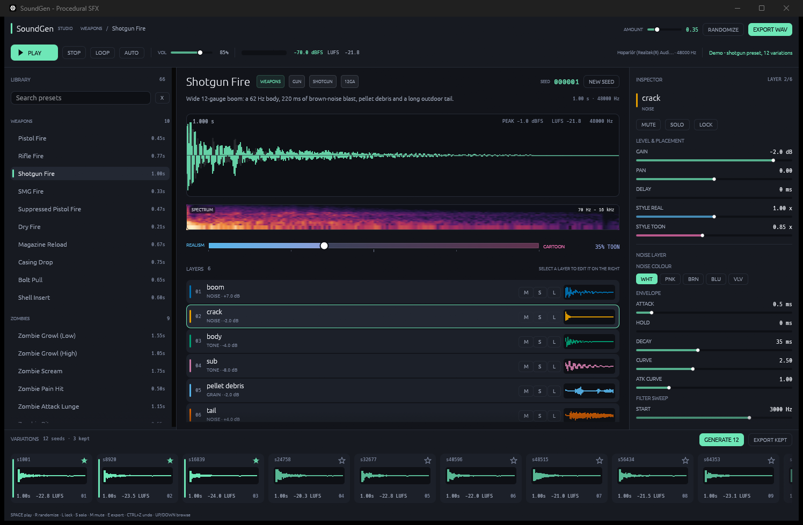

# SoundGen

**Zombi oyunları için prosedürel ses efekti stüdyosu.** Örnek dosya kullanmaz: silah sesinden
konfeti patlamasına, pervane döngüsünden zombi hırıltısına kadar her sesi katmanlı sentezle
sıfırdan üretir; anında dinletir, düzenletir ve WAV olarak dışa verir.



```
Rust 1.85+ · egui/eframe 0.37 · cpal 0.18 · Windows (WASAPI)
```

## Neden

Bir zombi oyununda 300+ ses gerekir ve bunların çoğu birbirinin akrabasıdır. SoundGen bunu
**parametre + tohum** problemine çevirir:

- **Katman (Layer):** her efekt 2-6 katman — transient, gövde, kuyruk, süs.
- **Stil ekseni:** `0.0` gerçekçi/fiziksel ↔ `1.0` çizgi film/abartılı.
- **Aile (Family):** tek ses değil, aynı karakteri paylaşan 8-12 tohumlu varyasyon.

Aynı reçeteden 12 farklı ama tanıdık varyasyon çıkar; birini beğenip yıldızlarsınız ve sadece
beğendikleriniz dışa aktarılır.

## Kütüphane

66 fabrika reçetesi, 9 kategori:

| Kategori | Adet | Örnekler |
|---|---|---|
| Weapons | 10 | pistol, rifle, shotgun, SMG, suppressed, dry fire, reload, casing, bolt, shell |
| Zombies | 9 | low/high growl, scream, pain hit, lunge, bite, death rattle, idle breath, horde bed |
| Gore | 8 | flesh hit, slash, bone break, head pop, body fall, blood splat, dismember, crunch |
| Foley | 8 | footstep ×4 zemin, body land, cloth rustle, door creak, glass debris |
| Loops | 6 | small/large propeller, drone motor, helicopter, wind, campfire |
| Crates | 6 | wood, metal, plastic açılış + kırılma varyantları |
| Celebration | 6 | confetti pop, party horn, crowd cheer, coin, fanfare |
| UI | 8 | click, hover, confirm, cancel, error, notify, swipe, toggle |
| Ambience | 5 | wind, cave drip, distant moan, room tone, rain |

Döngüler (`Loops`) tam sayıda pervane geçişine göre ayarlanır ve renderer'ın dairesel
crossfade'i ile dikişsiz birleşir: ölçülen seam oranı 0.00-0.57 (1.5 eşiği).

## Hızlı başlangıç

```powershell
# uygulama
cargo run --release -p soundgen

# dolu varyasyon ailesiyle aç (README ekran görüntüsü / demo)
cargo run --release -p soundgen -- --demo

# kütüphaneyi listele
cargo run -p soundgen-cli -- list

# tüm kütüphaneyi 4 varyasyonla WAV olarak dışa ver
cargo run --release -p soundgen-cli -- render --out out --variations 4 --style 0.35 --bits 16

# sadece silahlar, 24-bit
cargo run --release -p soundgen-cli -- render --out out --only weapon --bits 24

# kalite kontrolü (süre / peak / LUFS / NaN)
cargo run -p soundgen-cli -- stats
```

## Klavye kısayolları

| Tuş | İşlev |
|---|---|
| `Space` | çal / durdur |
| `R` | varyasyon üret (randomize) |
| `L` | seçili katmanı kilitle (randomize dokunmaz) |
| `S` / `M` | seçili katmanı solo / mute |
| `E` | WAV dışa ver |
| `↑` / `↓` | önceki / sonraki preset |
| `Ctrl+Z` | geri al (50 adım) |

## Kasa yapısı

| Yol | İçerik |
|---|---|
| `crates/sg-dsp` | RNG, gürültü renkleri, ADSR, TPT SVF, biquad, osilatör, modal bank, efektler |
| `crates/sg-engine` | `Recipe` / `Layer` modeli, offline renderer, `AudioBuffer` analizi |
| `crates/sg-presets` | fabrika kütüphanesi (kategori başına bir modül) |
| `crates/sg-io` | WAV yazımı + cpal çalar |
| `apps/soundgen` | egui stüdyo arayüzü |
| `apps/soundgen-cli` | toplu render + QA |

## Dokümanlar

- [`docs/00-BRIEF.md`](docs/00-BRIEF.md) — ürün brifingi
- [`docs/ARCHITECTURE.md`](docs/ARCHITECTURE.md) — mimari kararlar ve render hattı
- [`docs/API-CHEATSHEET.md`](docs/API-CHEATSHEET.md) — preset yazma rehberi
- [`docs/QA.md`](docs/QA.md) — üretilen seslerin süre / peak / LUFS / seam raporu
- [`docs/adr/`](docs/adr) — mimari karar kayıtları
- `docs/research/01-dsp-sentez.md` — sentez teknikleri, kategori reçeteleri, stil haritası
- `docs/research/02-arac-ux.md` — profesyonel araç teardown'ı, arayüz ve akış
- `docs/research/03-stack.md` — teknoloji yığını karşılaştırması
- `docs/research/04-entegrasyon.md` — Unity/FMOD/Wwise sözleşmesi, loudness, isimlendirme

## Durum

- [x] DSP çekirdeği (modal, granüler, rotor, sweep, ton, gürültü)
- [x] Offline render + düşük gecikmeli oynatma
- [x] Stil ekseni (gerçekçi ↔ çizgi film)
- [x] Tohumlu varyasyon ailesi
- [x] WAV export (16/24-bit, mono/stereo)
- [x] Kategori kütüphanesi (silahlar, zombiler, gore, foley, döngüler, kasalar, kutlama, UI, ambiyans)
- [x] egui stüdyo arayüzü (dalga formu, spektrogram, katman denetçisi, varyasyon ailesi)
- [x] Dikişsiz döngüler (dairesel crossfade, tam süre)
- [ ] Fiziksel modelleme v0.2 (temas kuvveti, modal gövde, formant ses)
- [ ] JSON sidecar + Unity Addressables importer
- [ ] VST3 / runtime kütüphane

## Lisans

MIT (kod). Üretilen sesler sizindir.
